# 设计见解：常见结构特征的相关标准赏析

!!! abstract

    本文注意涉及的结构特征包括：

    - 螺钉通孔
    - 普通螺纹的收尾、肩距、退刀槽和倒角尺寸
    - 切削加工件的倒角与倒圆角

!!! tip 

    遵循相关标准(国标、行业标准等)，有如下优势：

    - 确保可加工性，即任何一家外协厂都可以生产出同样结构的零部件。
    - 任何一个接手的人都能理解当初的设计意图，并可在图纸技术要求里写明相关标准。
    - 任何一次评审都有权威的标准背书(很多情况下是国标、ISO标准的双层背书)，评审专家难以反驳；反之，需要说明为什么不遵守标准，并举证说明自己设计的合理性、可行性。当然，如果零部件的特征需要非标的情况，另论。
    - 遵循标准等于继承了整个行业的经验，而不是自己重新拍脑袋。

## 1. 螺钉通孔

此部分主要解决在螺钉通孔结构参数给定的相关问题，注：螺钉通孔某些时候也被称为“螺钉过孔”。

> 比如M5的螺钉，螺钉过孔是5.3、5.4、5.5、5.8，还是什么呢？

GB/T 5277-85，紧固件 螺栓和螺钉通孔，等效采用ISO 273-1979，要点如下：

- 按精密程度，可分为精装配、中等装配、粗装配3个系列。
- 精装配、中等装配、粗装配3个系列，通孔公差分别默认为：H12、H13、H14。
- 如有必要避免通孔边缘与螺栓头下圆角发生干涉时，建议倒角。
下图为标准局部截图，来自GB/T 5277-85。

<figure markdown="span">
    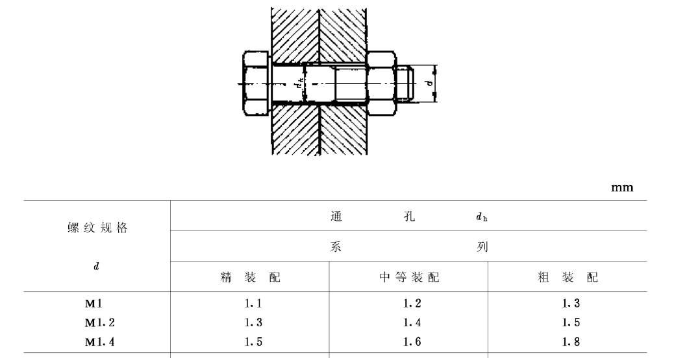{ width="720" }
    <figcaption>GB-T-5277-85-Screenshot</figcaption>
</figure>

注：应提前思考螺钉通孔的精密程度系列，并在同一设备中尽量执行同样的系列。

下图为M5螺钉过孔(此处假设非精密设备)，执行粗装配时的标注示例，通孔直径数据参考国标。

<figure markdown="span">
    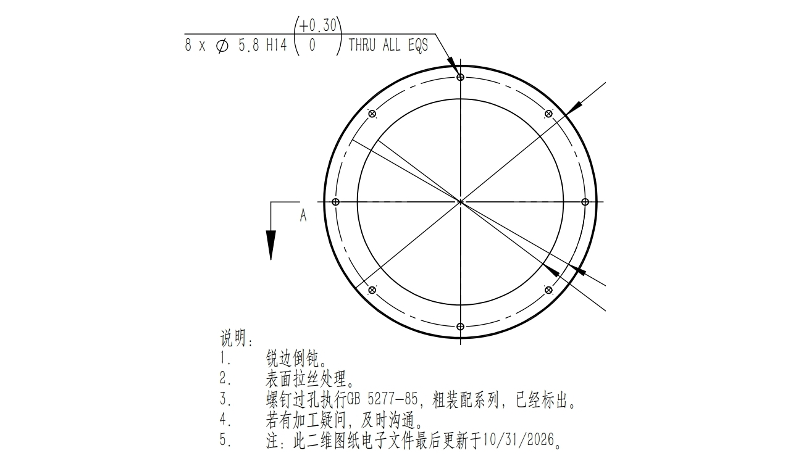{ width="720" }
    <figcaption>M5-Screw-Clearance-Hole-Dimensioning-Example</figcaption>
</figure>

## 2. 普通螺纹的收尾、肩距、退刀槽和倒角尺寸

此部分主要解决与螺纹结构参数给定的相关问题，对于退刀槽等参数甚至关系到可加工性。

GB/T 3-1997，普通螺纹收尾、肩距、退刀槽和倒角，等效采用ISO 3508-1976、ISO 4755-1983，要点如下：

- 外螺纹选择收尾还是退刀槽的形式，关键在于是否满足功能要求、装配要求和工艺可行性，下表是适用情形：

| 情形 | 选择 | 理由 |
| --- | --- | --- |
| 标准紧固件（螺栓/螺钉） | 收尾 | 滚压成形的螺纹必然有收尾；开槽会严重削弱有效牙型和截面强度。 |
| 螺母必须拧到贴死轴肩 | 开退刀槽 | 若无退刀槽，螺母往往会在最后几牙被不完整螺纹卡住，导致拧不到位。 |
| 密封/预紧有要求（如密封堵头） | 开退刀槽 | 若拧不到位，意味着压紧力不足，密封面难以可靠压紧，进而容易出现密封失效。 |

- 下图为外螺纹收尾形式的国标截图：

<figure markdown="span">
    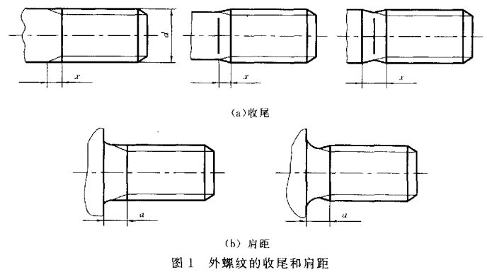{ width="720" }
    <figcaption>External-Thread-Runout-Form-Schematic</figcaption>
</figure>

- 下图为外螺纹退刀槽形式的国标截图：

<figure markdown="span">
    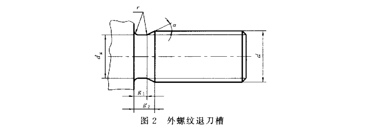{ width="720" }
    <figcaption>External-Thread-Relief-Groove-Form-Schematic</figcaption>
</figure>

> 国标有如下具体的要求：

- 外螺纹退刀槽过渡角(α)不应小于30°。
- 外螺纹始端端面的倒角一般为45°，也可采用60°或30°倒角；倒角深度应大于或等于螺纹牙型高度。

> 以一密封堵头(需要拧到位)的外螺纹退刀槽举例：

- 以螺距/P = 1.5 的退刀槽的尺寸参数举例，下图为想当然的错误建模(标注)方式。此处的标注仅显示退刀槽及螺纹相关参数，不涉及密封凹槽的参数，对于零件的实际耐压等核心参数更没有透露，因此展示实际零件图片作者认为是合适的。

<figure markdown="span">
    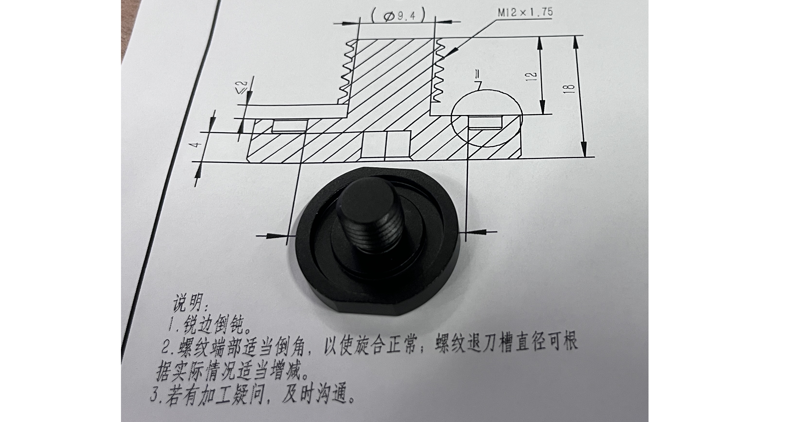{ width="720" }
    <figcaption>External-Thread-Relief-Groove-Incorrect-Dimensioning-Example</figcaption>
</figure>

- 以螺距/P = 1.5 的退刀槽的尺寸参数举例，下图为遵守国标的标注方式，图中红色框内的为螺纹相关参数；注意，针对任意螺距，无论收尾还是退刀槽形式，相关参数在该标准中都有规定，可查阅获取，此处不一一举例(显然我们也无法获得公开这些数据的授权)。

<figure markdown="span">
    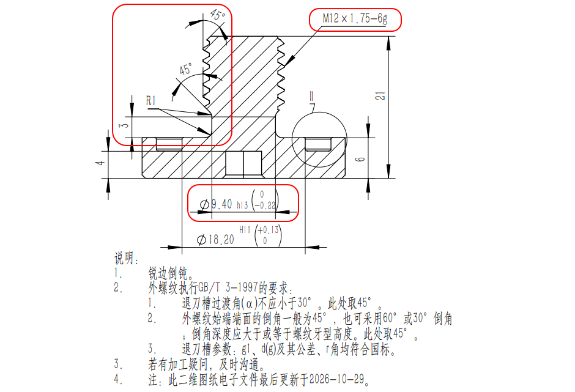{ width="720" }
    <figcaption>External-Thread-Relief-Groove-Correct-Dimensioning-Example</figcaption>
</figure>

> 内螺纹有如下考量点：

- 内螺纹，对常见的盲孔攻丝，通常采用收尾，并把底孔深度设计得大于所需的有效螺纹长度。多出的深度用于容纳丝锥前端的不完整牙、螺纹收尾及切屑，并避免螺栓先顶到孔底。
- 内螺纹，只有当结构需要螺纹延伸到孔底或台阶附近、且普通收尾空间不足时，才考虑按标准设置退刀槽。

> 内螺纹标注举例如下：

- 内螺纹的收尾结构参数参考国标要求。以M6国标螺纹孔举例，其螺距P = 1 mm，若采用常见的收尾形式，肩距A取一般长度系列为5 mm，若需要螺纹段长度为10 mm，则可标注为如下图所示，并在技术要求中写明为如下：
- 内螺纹执行GB/T 3-1997的收尾形式要求：
    - 肩距A取一般长度系列。
    - 入口端面的倒角一般为120°，也可采用90°倒角；端面倒角直径为：(1.05~1)D，D为螺纹公称直径代号。此处取入口端面的倒角为120°。

<figure markdown="span">
    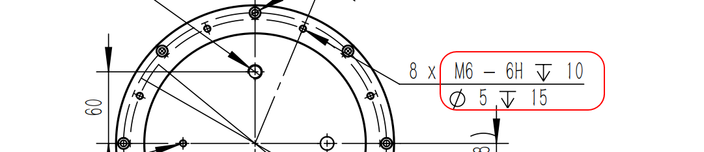{ width="720" }
    <figcaption>M6-Threaded-Hole-Dimensioning-Example</figcaption>
</figure>

## 3. 倒角与倒圆角

此部分主要解决倒角、倒圆角适用场景分析，倒角、倒圆的具体取值介绍，避免自己重新拍脑袋。
此部分内容，在某些地方受到机械设计工程师黄玉琳的启发。

GB/T 6403.4-2008，零件倒圆与倒角，要点如下：

注：此标准没有采标于ISO等标准，为[公开获取](https://std.samr.gov.cn/)的状态，此处会多引用一些图片等资源。

- 适用范围：规定了<mark>一般机械切削加工零件</mark>的外角和内角的倒圆、倒角。
- 倒圆、倒角型式：倒角定义为直角边长度及斜边夹角，如下图国标所示。

<figure markdown="span">
    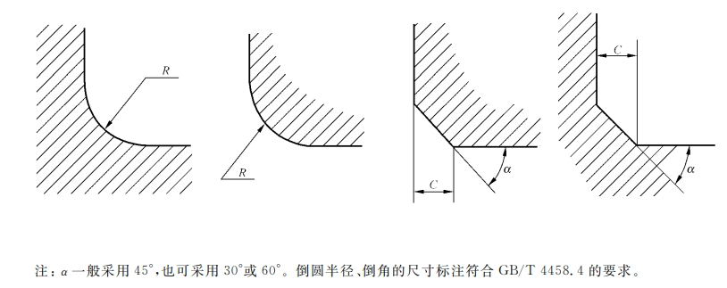{ width="720" }
    <figcaption>Rounding-and-Chamfering-Forms</figcaption>
</figure>

- 倒圆、倒角尺寸系列值有明确的规定，可参考执行。注意：系列值中没有1.5 这个数据。
- 内角、外角分别为倒圆、倒角（倒角为45°）的装配型式，其取值要求及示意图如下图(以内角倒角，外角倒圆举例)国标所示，其余搭配形式(如外角倒角，内角倒圆)参考国标。国标并给出如下建议：
    - 内角与外角取值要适当，外角的倒圆或倒角过大会影响零件工作面，内角的倒圆或倒角过小会产生应力集中。

<figure markdown="span">
    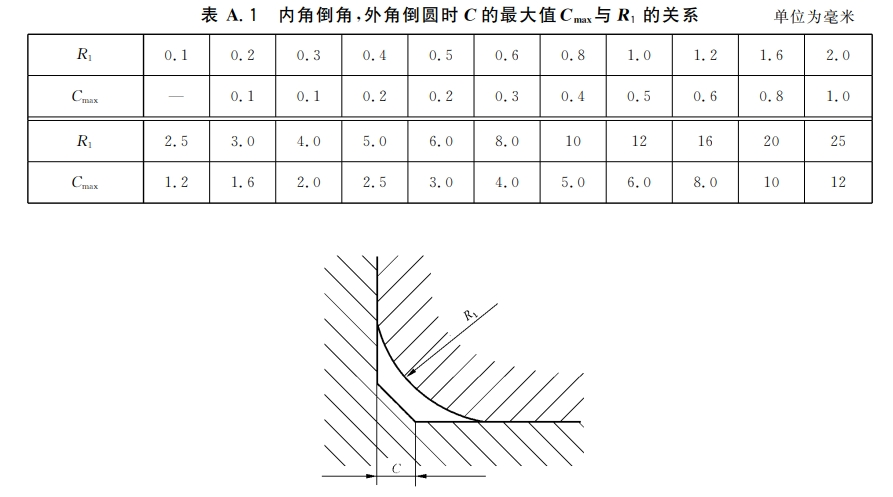{ width="720" }
    <figcaption>Internal-Chamfer-External-Rounding-Assembly-Requirements</figcaption>
</figure>

- 与直径Φ相应的倒角C、倒圆R 的推荐值如下图国标所示。

<figure markdown="span">
    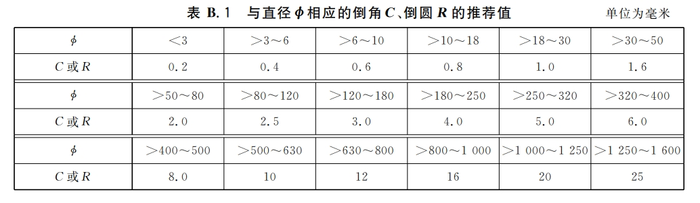{ width="720" }
    <figcaption>Recommended-Chamfer-and-Rounding-Values</figcaption>
</figure>

> 下表是C角、R角的工程选型参考，并非标准条文。GB/T 6403.4-2008给出了倒圆、倒角的型式和尺寸系列推荐值；具体尺寸应结合零件功能、配合关系及加工方法确定。

| 特征 | 常见适用场景 | 选型与设计注意 |
| --- | --- | --- |
| 外角C角 | 去除锐边、便于去毛刺； 法兰凸台、轴端等需要装配导入的边缘。 | 只有在配合件、入口间隙及倒角方向相匹配时，才能发挥导向作用； 倒角过大可能缩小接触面、影响定位或削弱边缘。 |
| 外角R角 | 设备外露且容易被手触及的边缘，可改善触感； 受力路径发生转折、需要避免尖锐几何突变的位置。 | 圆滑过渡可降低尖角处的应力集中趋势，但不能替代强度校核； 圆角过大可能侵占工作面或干涉配合件。 |
| 内角C角 | 内部边缘需要去锐、去毛刺，或与配合件边缘避让时。 | 核对倒角刀具可达性、相邻壁面和剩余壁厚； 不能把倒角视为可加工出理想尖角的手段。 |
| 内角R角 | CNC铣削的腔体、槽或口袋等内侧交汇处； 需要减小尖角应力集中或为配合件留出避让时。 | 内圆角受刀具半径和特征深度限制，通常不能加工成锐角； 过小、过深的圆角可能需要更小刀具并增加加工难度，过大又可能影响装配空间。 详见作者整理的[内侧圆角的加工设计建议](https://www.bridgezhang.com/manufacturing/cnc-machining/#3)。 |

此外：加工成本没有适用于所有工艺的“R角一定比C角贵”结论：成本取决于尺寸、公差、数量及加工方法；例如小半径且较深的内圆角可能需要小刀具或额外工序。应优先采用标准推荐系列，并避免在无功能需求处标注过严的尺寸和公差。

下图为一水下舱体设备的倒圆倒角实际举例。

<figure markdown="span">
    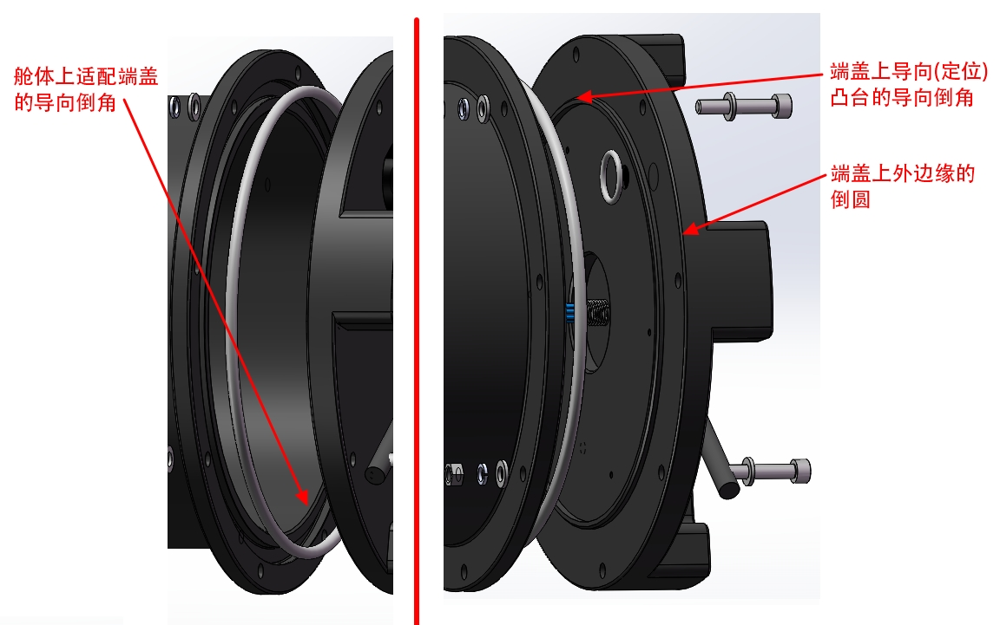{ width="720" }
    <figcaption>Flange-Assembly-Chamfer-and-External-Rounding-Examples</figcaption>
</figure>
