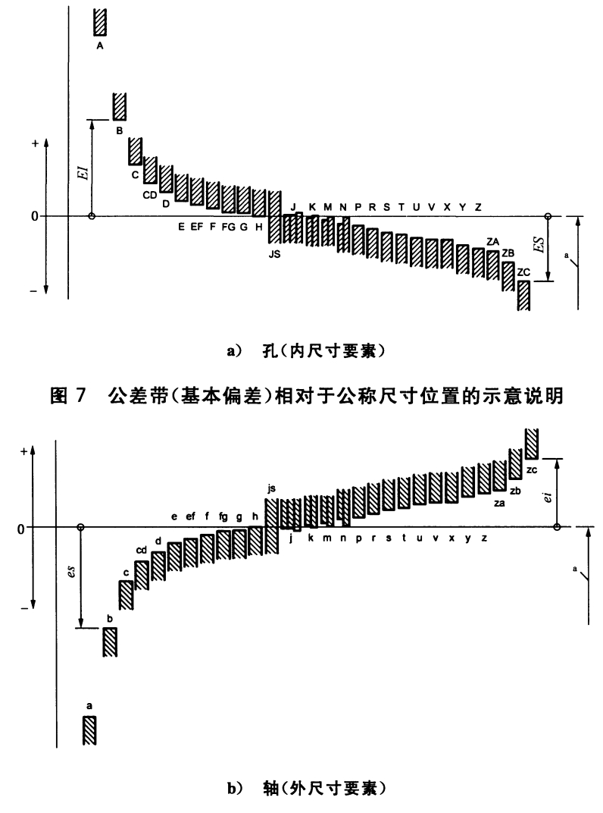
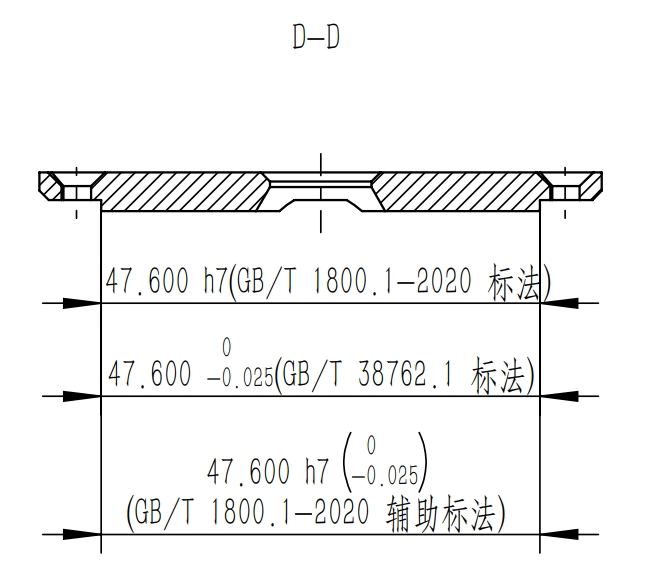

# 设计见解：线性尺寸公差入门

!!! abstract

    - 回顾线性尺寸公差的国家标准及相应的术语。
    - 案例解析-1：定位凸台的公差配合的选择
    - 案例解析-2：圆周均布的螺钉过孔其定位直径公差的选择
    - 案例解析-3：GB/T 3452.3-2005规定的轴向密封凹槽的公差选取的讨论

    公差设计不是枯燥的数字游戏，而是一门精妙地平衡  功能、成本(可加工性)与风险三者的“工程哲学”。

定位凸台(Locating boss)广泛应用于机械产品中，如电机法兰上的圆柱形定位止口(Locating pilot)、壳体上的安装凸台(Mounting boss)、工装夹具上的矩形定位凸台等。

本文主要讨论两方面内容：

* 常见定位凸台的类型及作用。
* 需要配合定位时，如何合理选择尺寸公差与几何公差。

## 1. 标准引用

- GB/T 1800.1-2020，产品几何技术规范（GPS） 线性尺寸公差ISO代号体系 第1部分：公差、偏差和配合的基础。[来源](https://std.samr.gov.cn/gb/search/gbDetailed?id=A47A713B760F14ABE05397BE0A0ABB25)
    - 本标准修改采用ISO国际标准：ISO 286-1:2010,MOD。
- GB/T 1800.2-2020，产品几何技术规范（GPS） 线性尺寸公差ISO代号体系 第2部分：标准公差带代号和孔、轴的极限偏差表
    - 本标准修改采用ISO国际标准：ISO 286-2:2010,MOD。
- GB/T 38762.1-2020，产品几何技术规范（GPS） 尺寸公差 第1部分：线性尺寸
    - 本标准修改采用ISO国际标准：ISO 14405-1:2016,MOD。
- GB/T 1804-2000，一般公差 未注公差的线性和角度尺寸的公差
    - eqv ISO 2768-1:1989。

!!! tip

    此文无意替代相应国标或是ISO标准，仅部分引用其经典术语，用于更准确、清晰的交流设计意图。

## 2. 公差配合的基本术语

本节所述术语代号均来自GB/T 1800.1-2020、GB/T 1800.2-2020，并给出其在标准中的章节位置。

- 公称尺寸/nominal size：由图样规范定义的<mark>理想形状要素</mark>的尺寸。(GB/T 1800.1-2020，3.2.1部分)

### 2.1. 关于偏差有如下定义

- 偏差/deviation：某值与其参考值之差。注：对于尺寸偏差，参考值是公称尺寸，某值是实际尺寸。(GB/T 1800.1-2020，3.2.4部分)
- 基本偏差/fundamental deviation：确定公差带相对公称尺寸位置的那个极限尺寸。(GB/T 1800.1-2020，3.2.6部分)
- 基本偏差/fundamental deviation：由下述方式识别与控制：(GB/T 1800.1-2020，4.1.2.5部分)
    - 对于孔，用大写字母(A，……ZC)。
    - 对于轴，用小写字母(a，……zc)。
    - 孔、轴的基本偏差数值，参考：GB/T 1800.1-2020，表2-表5。

公差带(基本偏差)相对于公称尺寸位置的示意图，如下图所示：对于孔而言，H代表下偏差为0，即所谓的基孔制；JS代表对称分布。

<figure markdown="span">
    { width="520" }
    <figcaption>Fundamental-Deviation-Schematic-Figure(取自GB/T 1800.1-2020，4.3.3部分)</figcaption>
</figure>

### 2.2. 关于公差有如下定义

- 公差/tolerance：上极限尺寸与下极限尺寸之差。注：是一个没有符合的绝对值。(GB/T 1800.1-2020，3.2.8部分)
- 标准公差/standard tolerance：IT/international tolerance，线性尺寸公差ISO代号体系中的任一公差。(GB/T 1800.1-2020，3.2.8.2部分)
- 标准公差等级/standard tolerance grade：用常用标示符表征的线性尺寸公差组。(GB/T 1800.1-2020，3.2.8.3部分)
    - 注：在ISO代号体系中，由IT及其后面的数字组成，如IT7。
    - 注：<mark>同一公差等级对所有公称尺寸的一组公差被认为具有同等精度等级</mark>。
    - 公称尺寸至3 150 mm的标准公差数值，参考：GB/T 1800.1-2020，表1。
- 公差带/tolerance interval：公差极限之间(包括公差极限)的尺寸变动值。(GB/T 1800.1-2020，3.2.8.4部分)
- <mark>公差带代号/tolerance class：基本偏差和标准公差等级的组合</mark>。注：在ISO代号体系中，公差带代号由基本偏差标示符与公差等级组成(如D13，h9等)(GB/T 1800.1-2020，3.2.8.5部分)
    - 尺寸及其公差，用极限偏差标注(GB/T 38762.1)与用公差带代号标注(GB/T 1800)等同。(GB/T 1800.1-2020，4.2.2部分)。
    - 当采用由公差带代号确定的公差标注时，为提供辅助信息目的等，可以括号的形式增加公差带代号，反之亦然。(GB/T 1800.1-2020，4.2.2部分)。如下图一端盖零件的凸台外径所示。

<figure markdown="span">
    { width="320" }
    <figcaption>Example-Of-Tolerance-Class</figcaption>
</figure>

### 2.3. 关于配合有如下定义

- 配合/fit：类型相同且待装配的外尺寸要素(轴)和内尺寸要素(孔)之间的关系。包括：(GB/T 1800.1-2020，3.2.3部分)
    - 间隙配合/clearance fit。
    - 过盈配合/interference fit。
    - 过渡配合/transition fit。
- 基孔制配合/hole-basis fit system：孔的基本偏差为零的配合，即其下极限偏差为零。可能示例：H7/h6、H7/k5等。(GB/T 1800.1-2020，3.4.1.1部分)

## 3. 案例解析-1：定位凸台的公差配合的选择

1、常见定位凸台的分类及作用

### 1.1. 螺钉连接与机械定位

螺钉、螺栓的主要作用是连接与紧固，通常不宜将其作为精确定位元件。螺栓与通孔之间存在间隙，不能仅依靠螺栓保证稳定、精确的相对位置。

对于有定位精度要求的金属零部件，通常采用定位止口、定位销、定位键等结构确定相对位置，再由螺钉提供夹紧力。

但这不是绝对原则：螺栓预紧力产生的摩擦也可以传递侧向载荷，关键在于设计是否明确考虑了预紧力、摩擦条件及载荷。

**特例：ADCP 塑料端盖**

Teledyne RDI WorkHorse II 等 ADCP 产品具有端盖、舱体及密封结构，可参考其[官方技术手册](https://www.teledynemarine.com/en-us/support/SiteAssets/RDI/Manuals%20and%20Guides/Workhorse%20II/WH2_Operation_Manual.pdf)。此塑料壳体的ADCP采用端面贴合与螺钉紧固而不设置独立安装凸台(如下图所示)，可能具有以下工程优势：

* **结构适应性：**塑料的弹性有助于适应一定的接触误差。
* **连接与载荷：**由于是塑料材质，螺钉预紧力可使接触面产生相比金属更大的摩擦力，从而抵抗一定的侧向载荷。

## 1.2. 常见类型

| 类型        | 常见应用        | 主要作用               |
| --------- | ----------- | ------------------ |
| 圆柱形定位止口   | 电机法兰、减速器、泵体 | 确定径向位置及轴线关系        |
| 安装凸台、支承凸台 | 壳体、支架、设备底座  | 提供安装平面、局部支承或螺纹连接位置 |
| 矩形或方形定位凸台 | 工装夹具、设备安装座  | 利用侧面定位，限制平面内移动或转动  |

## 2. 圆柱形定位止口：鸣志步进电机案例

### 2.1. 背景

以鸣志 ML23HS0P4100（NEMA 23）步进电机为例，厂家尺寸资料给出的前端法兰定位凸台直径为 **Φ38.1±0.05 mm**，凸出高度约为 **1.6 mm**。具体应以该型号官方尺寸图为准：[鸣志产品页面](https://www.moons.com.cn/p/nema-23-standard-hybrid-stepper-motors/ml23hs0p4100-000004611110011233)。

电机圆柱形定位止口，其外圆与安装板定位孔配合，确定电机的径向位置；法兰端面与安装板贴合，确定轴向位置并形成安装基准。

当电机与减速器、联轴器或丝杆等部件连接时，<mark>止口对轴系对中具有重要作用</mark>。但最终对中精度还取决于止口与电机轴线之间的制造关系，以及安装孔相对于设备其他基准的位置和姿态。

### 2.2. 公差配合的选择

已知厂家规定的止口直径范围为：

* 最小直径：38.05 mm
* 最大直径：38.15 mm
* 止口高度：约 1.6 mm

其直径公差宽度为 0.10 mm，与相应尺寸段的 IT10 公差值相近。

注意，在另一篇文章中，应说明，螺钉的过孔的定位直径公差带，应由公差带代号决定，而非机械的给定±0.05.

对于一般工业设备，如果目标是保证顺利装配，同时让止口承担径向定位功能，可以考虑将配套孔设计为 **Φ38.2 H8(即38.200～38.239 mm)**。这里的基本尺寸为 38.2 mm，是为了确保孔的最小尺寸大于厂家止口的最大尺寸，并非将孔与止口的名义尺寸机械地设成相同。

这一方案可作为普通设备的候选方案，但并非所有工况的唯一答案。若对电机轴线定位精度要求较高，应进一步评估最大间隙是否满足要求，并考虑缩小间隙或采用其他定位结构。

此外，安装孔不能只标注尺寸公差，还应根据功能要求控制其几何关系：

* 以安装端面作为基准，必要时控制孔轴线相对于端面的垂直度。
* 以设备其他定位基准为依据，必要时采用位置度控制孔的位置。
* 根据加工方法和精度要求，决定是否需要额外规定圆度、圆柱度等形状公差。

由于该止口的轴向接触长度只有约 1.6 mm，其对倾斜的约束能力有限。因此，不能仅凭止口短就认为垂直度不重要；应根据电机轴线的实际功能要求确定几何公差。

## 3. ## 2.1. 

安装凸台：铝合金水下舱体案例

### 3.1. 背景

在类似 ADCP 的水下设备中，如果主体采用铝合金舱体，端盖采用铝合金或其他刚性材料，可根据结构需要设置环形安装凸台或定位止口。

其作用包括：

* 提供端盖与舱体之间的安装、支承与简单的定位结构。
* 改善连接处的结构刚度。

### 3.2. 公差配合的选择

> 不宜凭经验任意指定固定间隙

例如，直接规定孔径比凸台直径大 1 mm，即单边间隙 0.5 mm，并不是普遍适用的设计方法。

主要问题如下：

* **尺寸尺度不同，效果不同。**相同的绝对间隙用于不同直径时，其相对尺寸比例不同；对于几何相似的结构，定位效果也可能不同。
* **缺乏可追溯依据。**如果间隙仅凭装配手感确定，就难以说明该值如何满足定位精度、载荷和加工要求。
* **间隙过大可能削弱定位作用。**凸台与孔之间的径向游隙增大，零部件可能发生相对偏移，进而影响轴系对中。
* **间隙过小也有风险。**加工误差、形状误差、表面处理、温度变化及装配污染都可能导致装配困难甚至干涉。

需要补充的是：标准公差等级主要描述尺寸公差的大小，并不直接决定配合间隙。实际间隙由孔、轴的基本偏差及公差等级共同决定。

例如，Φ18.4 mm 和 Φ184 mm 的零件都采用 0.5 mm 单边间隙时，其配合松紧程度与定位效果不能简单视为相同。应根据公称尺寸、结构功能及实际配合要求选择公差，而不是仅凭一个固定间隙。

> 铝合金水下舱体：Φ184 mm 配合的评估

对于端盖安装凸台与舱体内孔均为 Φ184 mm 的结构，拟采用 **H9/f9**，在 180～250 mm 尺寸段，H9 孔的下偏差为 0，上偏差约为 +0.115 mm；f9 轴的上偏差为负值，公差带整体位于基本尺寸以下。按标准偏差计算，H9/f9 会形成具有一定范围的间隙配合。

其优点是装配相对容易，适合需要留有装配间隙的结构。

## 三、边界与风险

* **公差并非越严越好。**尺寸公差收紧通常会提高加工与检验成本；若实际形状误差、毛刺或表面处理未受控，仍可能发生装配困难。
* **尺寸公差不能替代几何公差。**孔径合格不代表孔轴线的位置、姿态及圆柱形状必然满足要求。
* **定位与承载应分别分析。**止口可用于径向定位，但是否适合承担较大侧向力，应结合接触长度、材料强度、接触压力及结构刚度判断。
* **止口不宜无必要地加长。**长度增加可能改善倾斜约束，但也会提高对圆柱度、直线度、同轴关系和加工质量的要求。
* **密封设计优先于配合习惯。**对于水下设备，必须把密封圈、耐压、温度变化和材料特性一并考虑。

## 4. 案例解析-2：圆周均布的螺钉过孔其定位直径公差的选择

一台设备的转接法兰（两件完全相同，用 M12 螺钉组对连接）：

| 项目 | 数值 |
| --- | --- |
| 材料 / 厚度 | 304 不锈钢，12 mm 板 |
| 外径 | Ø160 mm |
| 螺钉过孔 | 8 × Ø13.5，圆周均布 |
| 孔组定位圆（PCD） | Ø130 mm |
| 功能要求 | 螺钉正常穿过即可，无定心 / 无定位要求 |

值得注意的是：GB/T 5277-1985，紧固件 螺栓和螺钉通孔，规定：对于M12的螺钉，精装配、中等装配、粗装配的螺钉过孔直径及默认公差分别为13 (H12)、13.5(H13)、14.5(H14)。

候选工艺：
	
- 12 mm 板激光切割一次成形；
- 铣床 / 加工中心铣削。

争议集中在 Ø130 这个"定位直径"该给多少公差：
- 不标注、按 GB/T 1804-m → ±0.5（120～400 段）；
- 想当然标 ±0.05 → 等效 IT9 的对称带（js9/JS9），激光做不到(激光切割的定位直径一般控制在±0.1左右)；
- 铣削按经济加工的能力范围(IT7-IT8)，此处取IT8 算 → ±0.032 mm，标 ±0.05"似乎合适"。