# 设计见解：线性尺寸公差入门

!!! abstract

    - 回顾线性尺寸公差的国家标准及相应的术语。
    - 案例解析-1：定位凸台的公差配合的选择。
    - 案例解析-2：圆周均布的螺钉过孔其定位直径公差的选择。
    - 对线性尺寸公差设计的讨论。

!!! tip

    - 公差设计需要平衡  功能、成本(可加工性)与风险三者之间的关系。
    - 本文案例-2，看似简单，若严格执行国家标准，会涉及形位公差，可知线性尺寸公差并非孤立的存在，很多时候只是被忽略或是处于次要的位置。
    - 本文意在强调设计时应有<mark>公差预留意识</mark>，尤其是有相互配合关系的地方，这对于可装配性比较重要。
    - 本文无意替代相应国标或是ISO标准，仅部分引用其经典术语，用于更准确、清晰的交流设计意图。

## 1. 标准引用

- GB/T 1800.1-2020，产品几何技术规范（GPS） 线性尺寸公差ISO代号体系 第1部分：公差、偏差和配合的基础。[来源](https://std.samr.gov.cn/gb/search/gbDetailed?id=A47A713B760F14ABE05397BE0A0ABB25)
    - 本标准修改采用ISO国际标准：ISO 286-1:2010,MOD。
- GB/T 1800.2-2020，产品几何技术规范（GPS） 线性尺寸公差ISO代号体系 第2部分：标准公差带代号和孔、轴的极限偏差表
    - 本标准修改采用ISO国际标准：ISO 286-2:2010,MOD。
- GB/T 38762.1-2020，产品几何技术规范（GPS） 尺寸公差 第1部分：线性尺寸
    - 本标准修改采用ISO国际标准：ISO 14405-1:2016,MOD。
- GB/T 1804-2000，一般公差 未注公差的线性和角度尺寸的公差
    - eqv ISO 2768-1:1989。

## 2. 公差配合的基本术语

本节所述术语代号均来自GB/T 1800.1-2020、GB/T 1800.2-2020，并给出其在标准中的章节位置。

- 公称尺寸/nominal size：由图样规范定义的<mark>理想形状要素</mark>的尺寸。(GB/T 1800.1-2020，3.2.1部分)

### 2.1. 关于偏差有如下定义

- 偏差/deviation：某值与其参考值之差。注：对于尺寸偏差，参考值是公称尺寸，某值是实际尺寸。(GB/T 1800.1-2020，3.2.4部分)
- 基本偏差/fundamental deviation：确定公差带相对公称尺寸位置的那个极限偏差。(GB/T 1800.1-2020，3.2.6部分)
- 基本偏差/fundamental deviation：由下述方式识别与控制：(GB/T 1800.1-2020，4.1.2.5部分)
    - 对于孔，用大写字母(A，……ZC)。
    - 对于轴，用小写字母(a，……zc)。
    - 孔、轴的基本偏差数值，参考：GB/T 1800.1-2020，表2-表5。

公差带(基本偏差)相对于公称尺寸位置的示意图，如下图所示：对于孔而言，H代表下偏差为0，即所谓的基孔制；JS代表对称分布。

<figure markdown="span">
    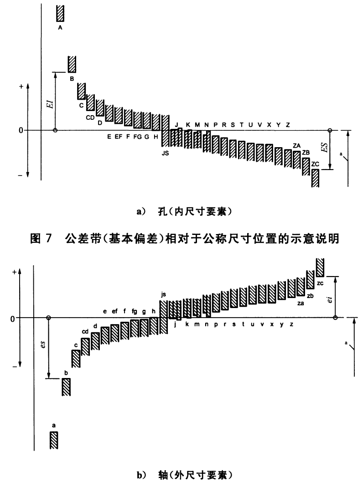{ width="520" }
    <figcaption>Fundamental-Deviation-Schematic-Figure(取自GB/T 1800.1-2020，4.3.3部分)</figcaption>
</figure>

### 2.2. 关于公差有如下定义

- 公差/tolerance：上极限尺寸与下极限尺寸之差。注：是一个没有符号的绝对值。(GB/T 1800.1-2020，3.2.8部分)
- 标准公差/standard tolerance：IT/international tolerance，线性尺寸公差ISO代号体系中的任一公差。(GB/T 1800.1-2020，3.2.8.2部分)
- 标准公差等级/standard tolerance grade：用常用标示符表征的线性尺寸公差组。(GB/T 1800.1-2020，3.2.8.3部分)
    - 注：在ISO代号体系中，由IT及其后面的数字组成，如IT7。
    - 注：<mark>同一公差等级对所有公称尺寸的一组公差被认为具有同等精度等级</mark>。
    - 公称尺寸至3 150 mm的标准公差数值，参考：GB/T 1800.1-2020，表1。
- 公差带/tolerance interval：公差极限之间(包括公差极限)的尺寸变动值。(GB/T 1800.1-2020，3.2.8.4部分)
- <mark>公差带代号/tolerance class：基本偏差和标准公差等级的组合</mark>。注：在ISO代号体系中，公差带代号由基本偏差标示符与公差等级组成(如D13，h9等)(GB/T 1800.1-2020，3.2.8.5部分)
    - 尺寸及其公差，用极限偏差标注(GB/T 38762.1)与用公差带代号标注(GB/T 1800)等同。(GB/T 1800.1-2020，4.2.2部分)。
    - 当采用由公差带代号确定的公差标注时，为提供辅助信息目的等，可以括号的形式增加公差带代号，反之亦然。(GB/T 1800.1-2020，4.2.2部分)。如下图一端盖零件的凸台外径所示。

<figure markdown="span">
    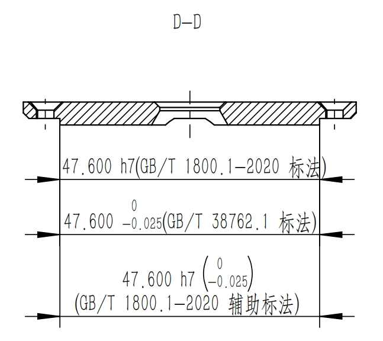{ width="320" }
    <figcaption>Example-Of-Tolerance-Class</figcaption>
</figure>

### 2.3. 关于配合有如下定义

- 配合/fit：类型相同且待装配的外尺寸要素(轴)和内尺寸要素(孔)之间的关系。包括：(GB/T 1800.1-2020，3.2.3部分)
    - 间隙配合/clearance fit。
    - 过盈配合/interference fit。
    - 过渡配合/transition fit。
- 基孔制配合/hole-basis fit system：孔的基本偏差为零的配合，即其下极限偏差为零。可能示例：H7/h6、H7/k5等。(GB/T 1800.1-2020，3.4.1.1部分)

### 2.4. 关于未注尺寸公差

- 一般公差/general tolerances：指在车间<mark>通常加工条件下</mark>可保证的公差。采用一般公差的尺寸,在该尺寸后不需注出其极限偏差数值。(GB/T 1804-2000，3.2部分)
- 一般公差分精密f、中等m、粗糙c、最粗v共4个公差等级。按未注公差的线性尺寸和角度尺寸分别给出了各公差等级的极限偏差数值。(GB/T 1804-2000，5部分)  注：具体数据参考国标。

## 3. 案例解析-1：定位凸台的公差配合的选择

### 3.1. 背景

- 定位凸台是常见的机械结构特征，首要功能是定位，在某些场合还承担导向、提供部分径向力的作用。其次，在某些场合，定位凸台也称为止口。
- 从功能的实现而言，由于螺钉(通常搭配弹平垫、螺母)只提供轴向的夹紧力，不能保证零部件之间的径向位置关系，因此需要凸台、止口等结构来实现定位功能。

### 3.2. 水下舱体端盖的定位凸台

> V1版本

- 在此设计案例中，V1版本甚至没有设置定位凸台，直接靠螺钉夹紧端盖与舱体，虽然也能成功装配，但由于缺乏径向定位结构，也导致螺钉螺纹容易被螺钉通孔磨损，显然也增加了装配难度。如下图所示。

<figure markdown="span">
    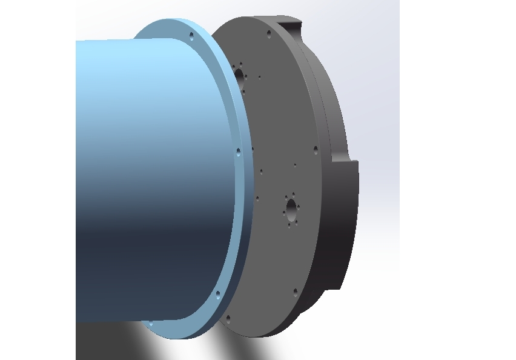{ width="720" }
    <figcaption>Underwater-Housing-End-Cover-Without-Locating-Boss</figcaption>
</figure>

> V2版本

- 在此设计案例中，V2版本的端盖新增了定位凸台，其作用是提供端盖与舱体之间的安装导向及定位，在端盖受到较大径向力时也能辅助提供部分径向力。如下图所示。

    <figure markdown="span">
        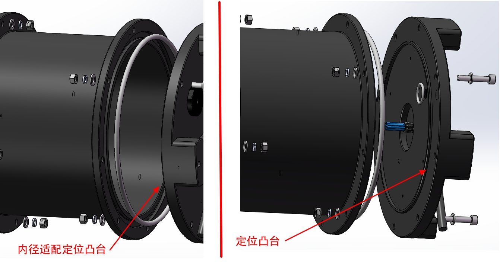{ width="720" }
        <figcaption>Underwater-Housing-End-Cover-With-Locating-Boss</figcaption>
    </figure>

    - 在此设计案例中，V2版本的端盖定位凸台的直径设置为182 mm、高度设置为3 mm，舱体内孔未经公差分析即设置为184 mm，由一般公差 GB/T 1804-2000 控制。如下图所示。

    <figure markdown="span">
        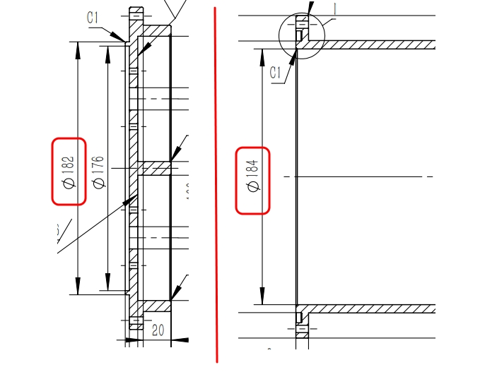{ width="720" }
        <figcaption>Underwater-Housing-V2-Locating-Boss-Dimensioning</figcaption>
    </figure>

    - 此种设计也能装配并起到导向、定位甚至提供径向力的功能，但由于缺乏可追溯的公差依据，无法解释为何此配合单边间隙是1 mm((184-182)/2)，接手的工程师将难以理解设计意图。
    - 此文2.2小节，国标明确指出：同一公差等级对所有公称尺寸的一组公差被认为具有同等精度等级；此处想当然的单边间隙，对于其它尺寸段显然是不合适的(比如针对舱体内径是100 mm，那么其在标准公差等级中处于80-120分段，同样的单边间隙会有更松弛的装配效果和更松的精度等级)。

> V3版本

- 在此设计案例中，V3版本的端盖定位凸台直径设置为184 e8(-0.100至-0.172) mm、高度设置为3 mm，舱体内孔为184 H9(0至+0.115) mm。如下图所示。

    <figure markdown="span">
        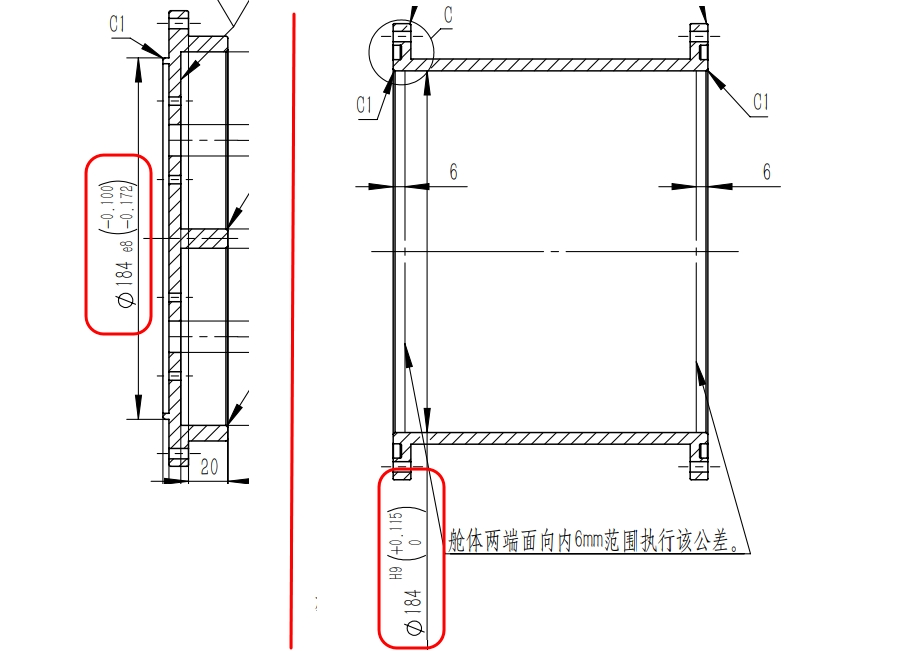{ width="720" }
        <figcaption>Underwater-Housing-V3-Locating-Boss-Dimensioning</figcaption>
    </figure>

    - 此种设计能装配并起到导向、定位、提供径向力的功能，同时有可追溯的公差依据，接手的工程师也能理解设计意图。
    - 凸台与孔之间单边间隙 0.05～0.1435 mm，主要提供装配导向与初始径向定位；螺钉夹紧后靠端面摩擦维持相对位置，持续径向载荷需由凸台侧面接触承受。
    - 至于为何是H9/e8的公差配合，这是GB/T 1800.1-2020中基孔制配合优先配合、间隙配合的一个选项，标准中 图12，主要是考虑到加工成本、装配难度、定位精度要求等因素的综合平衡。此处的配合间隙有意选取了较大值，若对定位精度要求更高，可考虑国标推荐的优先配合H8/f7等选项。
    - IT 9级公差对于舱体内孔、IT 8级公差对于凸台的外径，都属于经济性加工的范围。
    - 对于舱体非配合段的公差，可按GB/T 1804-2000未注公差的线性和角度尺寸的公差控制；应避免整个舱体内壁面都执行H9的公差。
    - 公差配合的标注参考作者整理的文章：[基本标注](https://www.bridgezhang.com/modeling/dimensioning/)。

### 3.3. 电机定位止口

- 下图为鸣志 ML23HS0P4100（NEMA 23）步进电机的前端法兰定位止口，在功能上与前述水下舱体端盖定位凸台类似，相关的设计比较类似，不再赘述。图源：[鸣志产品页面](https://www.moons.com.cn/p/nema-23-standard-hybrid-stepper-motors/ml23hs0p4100-000004611110011233)。

<figure markdown="span">
    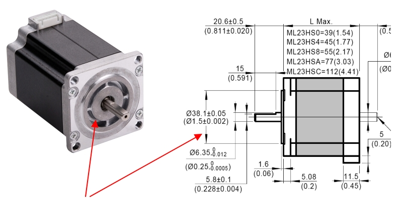{ width="720" }
    <figcaption>Stepper-Motor-Front-Flange-Locating-Pilot</figcaption>
</figure>

## 4. 案例解析-2：圆周均布的螺钉过孔其定位直径公差的选择

仍以案例解析-1中，水下舱体端盖上的螺钉过孔举例，准备采用8个均布的M6的螺钉来连接端盖和舱体。如下图所示。

<figure markdown="span">
    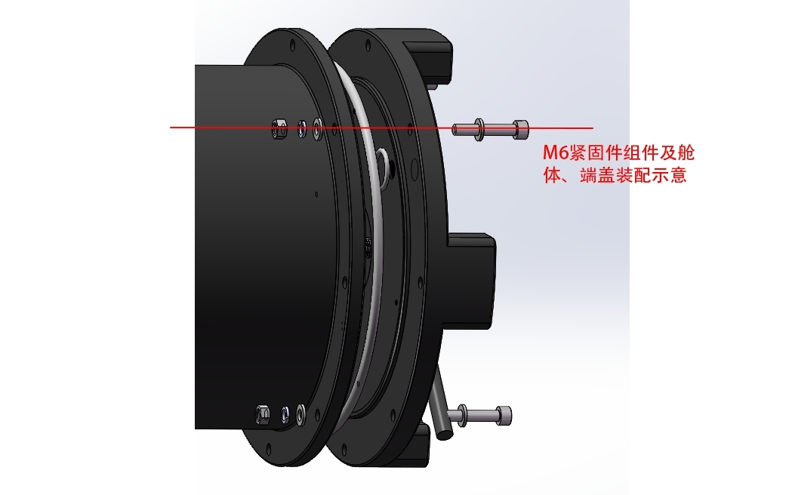{ width="720" }
    <figcaption>Underwater-Housing-M6-Screw-Assembly-Illustration</figcaption>
</figure>

| 项目 | 数值 |
| --- | --- |
| 螺钉通孔 | 8 × Ø6.6 H13，执行 GB/T 5277 中等装配系列，圆周均布 |
| 孔组定位圆（PCD） | Ø221 mm |
| 功能要求 | 螺钉正常穿过即可，不承担定心/定位功能 |
| 加工方式 | 铣削加工 |   

关于螺钉通孔直径的取值，请参考作者整理的文章：[设计见解：常见结构特征的相关标准赏析](https://www.bridgezhang.com/design/standards-of-common-structural-features/)。

> 争议集中在 Ø221 这个定位圆（PCD）该给多少公差？

- 不单独标注，统一执行 GB/T 1804-m（180～250 mm 分段，未注线性公差 ±0.5 mm）；
- 想当然标 ±0.05​ → 该数值接近 js9 标准公差带的对称偏差（Ø221 在 180～250 mm 分段，IT9 = 0.115 mm，js9 对称偏差为 ±0.0575 ≈ ±0.058）。对铣削而言，IT7～IT8 均为经济加工范围，IT9 比 IT7/IT8 低两个等级，加工更容易实现；
- 此外，孔组定位圆（PCD）直径公差并非唯一考量因素，螺钉通孔的圆周均布度（位置公差）也会影响螺钉的装配性。

如何考量呢？下面给出3种标注形式：

> 形式1：不标注，统一执行 GB/T 1804-m。如下图所示。

<figure markdown="span">
    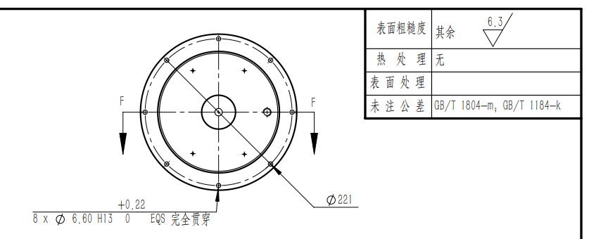{ width="720" }
    <figcaption>Circular-Patterned-Screw-Holes-Default-Tolerances</figcaption>
</figure>

- 定位圆直径 Ø221：180～250 mm 分段，未注线性公差 ±0.5 mm；
- 圆周均布角度（8×45°）：按 GB/T 1804-m 执行，角度公差由短边长度确定。本例短边约 86.8 mm（>50~120 mm 分段），未注角度公差为 ±20′（≈±0.333°）。该角度误差引起的孔中心径向偏移约为 R×sin(0.333°) ≈ 110.5×0.0058 ≈ ±0.64 mm，与径向 ±0.5 mm 的线性公差在同一量级，说明未注公差体系内部是自洽的；
- 螺钉通孔直径为 Ø6.6 H13（中等装配系列），单边间隙约 0.3 mm，通常能够顺利装配。
- 适用场景：外协加工、无定心要求、成本优先。

> 形式2：执行最大实体要求（MMR）——理论最优。如下图所示。

<figure markdown="span">
    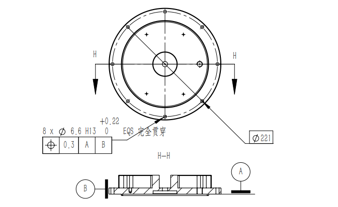{ width="720" }
    <figcaption>Circular-Patterned-Screw-Holes-Position-Tolerance-MMR</figcaption>
</figure>

- 以端盖底面为基准A，端盖中心轴线为基准B（由定位凸台/止口建立）；
孔组定位圆（PCD）Ø221 标注为理论正确尺寸（加方框）；
- 对 8 个 Ø6.6 H13 通孔标注位置度：相对于基准 A、B，位置度公差 Ø0.3 Ⓜ；
- 含义：当各孔处于最大实体状态（孔径最小 Ø6.6）时，各孔中心必须落在以理论正确位置为圆心、直径 Ø0.3 mm 的公差带内；当孔径做大时，位置度公差带可按偏离量补偿放大。补偿量 = 实际孔径 − 最大实体孔径（Ø6.6）（即偏离最大实体状态的距离），上限由 H13 公差决定；
- 举例：当实际孔径为 Ø6.7 时，偏离 MMS 0.10 mm，位置度公差带补偿放大为 Ø0.4 mm；当孔径做到 H13 上限 Ø6.82 时，位置度公差带可达 Ø0.52 mm；
- 原理：螺钉通孔本身有间隙，孔径做大后，即使孔组分布略有偏移，螺钉仍能穿过。最大实体要求正是利用这一间隙来放宽位置度要求，在批量生产中平衡加工经济性与装配性；
- 批量检验：可制作一个综合量规（基准销 + 定位销 + 通孔组通规），一次性验证圆周均布度与孔径的综合边界，无需逐孔测量坐标；
- 局限：对加工商的理解能力有一定要求。若加工商不熟悉几何公差或最大实体概念，可能出现加工偏差或报价争议。

> 形式3：执行常用的标注。如下图所示。

<figure markdown="span">
    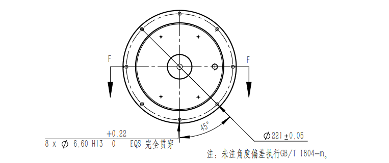{ width="720" }
    <figcaption>Circular-Patterned-Screw-Holes-PCD-and-Angular-Tolerances</figcaption>
</figure>

- 孔组定位圆（PCD）直径标注 Ø221 ±0.05（或选用标准公差带 js9，Ø221 ±0.058）；
- 圆周均布角度公差执行GB/T 1804-m（或按企业内部标准）；
- 针对具体情况需适当调整公差值，否则容易出现加工难度过大的问题。
- 适用场景：多数企业内部项目、加工商对形位公差理解有限但能读懂带公差的线性/角度标注。

结论：若从专业性而言，我们推荐形式2的标注，它最充分地利用了设计间隙，是 GPS 体系中处理孔组装配问题的标准解法；若从实际情况出发，我们更多会选择形式3的标注，除非在标准化、专业性很高的团队，他们有匹配的专业加工商。

## 5. 边界与风险

- 公差并非越严越好：尺寸公差收紧通常会提高加工与检验成本；若实际形状误差、毛刺或表面处理未受控，仍可能发生装配困难。
- 定位与承载应分别分析：止口可用于径向定位，但是否适合承担较大侧向力，应结合接触长度、材料强度、接触压力及结构刚度判断；建议结合具体工况进行接触应力校核。
- 止口不宜无必要地加长：长度增加可能改善倾斜约束，但也会提高对圆柱度、直线度、同轴关系和加工质量的要求。
- 密封设计优先于配合习惯：对于水下设备，必须把密封圈、耐压、温度变化和材料特性一并考虑。

!!! warning

    - 本文案例的讨论，是作者的个人理解，对于具体应用场景，仍需结合国标、实际功能要求、加工能力、装配工艺等因素综合评估。
    - 若您有相关的设计建议、经验或是不同的理解，欢迎与我们交流。
